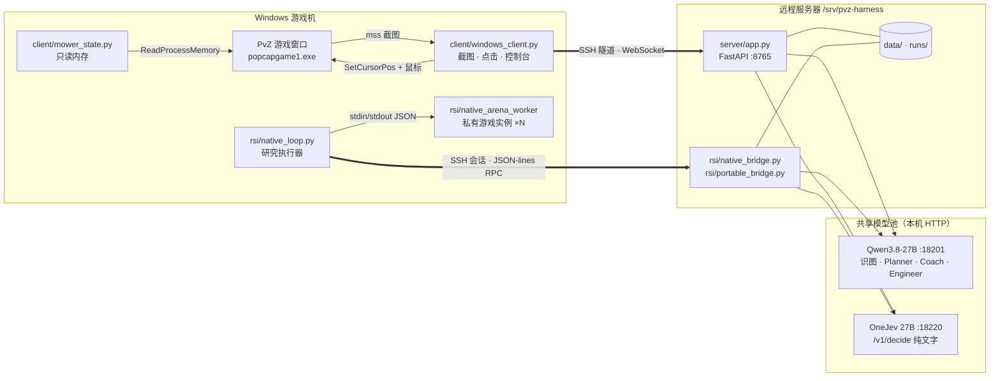
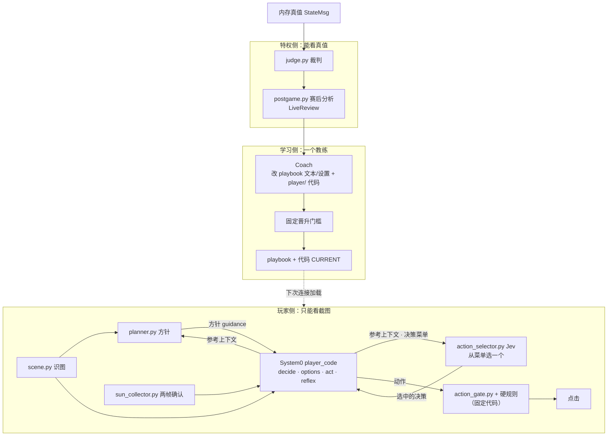
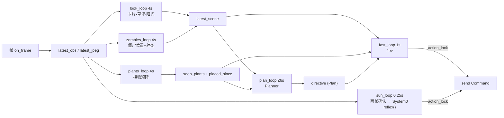
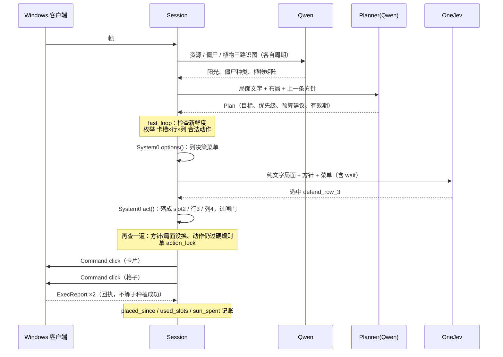
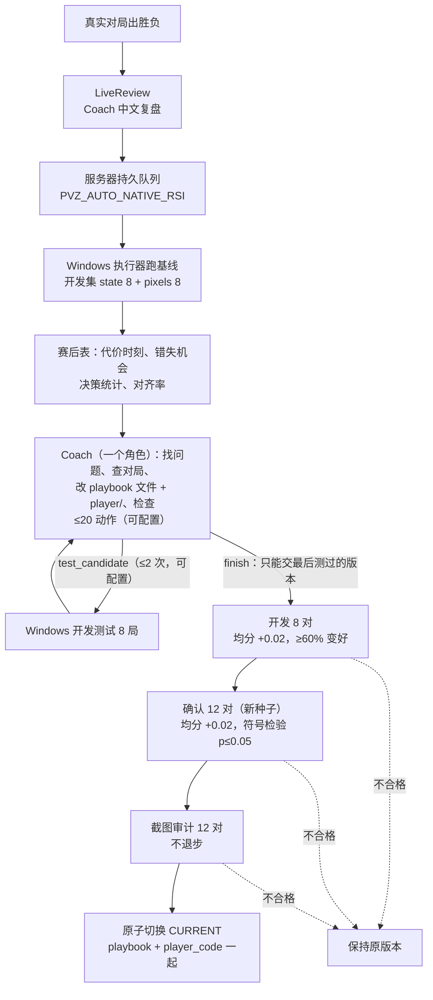

# pvz-agent 架构文档

> 部分细节是开发过程快照；当前结果与配置入口以 [PROJECT.md](PROJECT.md)、[reproduce.md](reproduce.md) 为准。

按 2026-11-01 的代码整理。项目现状、各路线进度和与绝悟的对比见 [PROJECT.md](PROJECT.md)；
本文只讲系统怎么拆、数据怎么流、谁有什么权限。

## 1. 目标与约束

目标：让通用大模型只看截图来玩《植物大战僵尸》（PvZ GOTY 1.2.0.1096），并能在不改模型权重的前提下，
通过修改策略和代码不断变好。

架构上的几条硬约束，决定了下面的大部分设计：

| 约束 | 带来的设计 |
|---|---|
| 游戏只在 Windows 上跑，模型只在远程服务器上跑 | 「反向云游戏」：客户端只截图和点击，所有判断在服务器 |
| 服务器只开放一个 SSH 端口 | 服务只监听 127.0.0.1，客户端经 SSH 隧道连 8765 |
| 模型池是别的团队的共享服务 | 每路调用串行、有超时、不补发；不在 Windows 上直接调模型 |
| 玩家只能看到人能看到的东西 | 内存真值只给裁判和教练，玩家侧代码不能 import 裁判 |
| 改进必须可审计、可回滚 | playbook 和代码候选不可变、按版本号/哈希保存，固定门槛晋升 |
| 模型可能出错或变慢 | 任何失败都等于「不操作」，不偷偷换规则兜底 |

## 2. 部署拓扑



两条通道：

- **实时对局**：`windows_client` ⇄ SSH 隧道 ⇄ `/ws`。一个连接对应一个 `Session`。
- **研究评测**：`native_loop` 用 `ssh -T` 在服务器上启动 `python -m rsi.native_bridge`（或 `portable_bridge`），
  通过它的标准输入输出走 JSON-lines RPC。游戏在 Windows 上跑，模型和晋升在服务器上做，凭据不离开服务器。

## 3. 三个侧面与权限

系统按「谁能看到什么、谁能做什么」分成三侧：



| 角色 | 能看到 | 能做 | 不能做 |
|---|---|---|---|
| Qwen 识图 | 截图 | 输出阳光数、僵尸种类、植物矩阵 | 决策、点击 |
| Planner | 识图结果、可选截图、上一条方针、System0 上下文 | 输出方针 `Plan`（目标、优先级、预算建议、战术说明） | 指定卡槽或格子、点击、暂停 |
| Jev（OneJev） | 纯文字局面 + 方针 + 选项（System0 的决策菜单，或内置的 卡槽×行×列） | 选一个或等待 | 看图、执行未列出的选项 |
| 收阳光确认（`sun_collector.py`） | 截图 | 给出两帧确认的阳光目标；没有 `reflex()` 时自己点 | 种植 |
| System0 | 识图结果、合法格子、确认的阳光、16×12 像素摘要、私有记忆 | 补上下文、请求重规划；列决策菜单；把 Jev 选中的决策落成一次种植；每 0.25 s 反射：选收哪些阳光，playbook 允许时种一株 | 绕过 Jev 选菜单决策、给坐标、绕过硬规则、看真值 |
| 动作闸门（`action_gate.py`） | System0 的输出 | 校验动作类型、每拍数量、阳光编号；种植再过硬规则 | 被任何模型修改 |
| 执行器（session） | 全部玩家侧数据 | 把通过闸门的动作编译成点击 | 自己选动作 |
| 裁判 | 内存真值 | 打分 | 影响玩家输入 |
| 赛后分析（`postgame.py`） | 研究局的引擎真值；实战日志 | 算代价时刻、错失机会、决策统计、对齐率 | 进入玩家输入 |
| Coach（一个角色） | 开发集结果和真值、赛后表、复盘、可查询的开发局 | 改 playbook 的策略笔记/计时/Jev 模式/反射设置和 `player/` 代码，请求测试、提交 | 改裁判、门槛、硬规则、闸门、模型契约，看确认/审计集 |
| 晋升门槛 | 配对评测报告 | 决定是否切换 CURRENT | 被任何模型修改 |

这些边界大多有测试守着，例如 `tests/test_isolation.py` 检查玩家侧模块不 import 裁判、不读 `StateMsg`。

## 4. 实时链路

### 4.1 连接建立

1. 客户端发 `Hello`（令牌、客户端名、游戏版本、可选固定 playbook）。服务器用 `hmac.compare_digest` 校验令牌。
2. 服务器加载 playbook（默认 `data/CURRENT`），建 `Session`，回 `Welcome`（会话名、playbook 版本）。
3. 启动六个循环任务：`fast_loop`、`plan_loop`、`look_loop`、`plants_loop`、`zombies_loop`、`sun_loop`。
4. 之后客户端持续发二进制帧（JPEG）和文本消息（`StateMsg`、`ExecReport`、`EpisodeEvent`）；服务器发 `Command` 和 `ModelTiming`。
5. 断开时取消全部循环，关闭日志；若这局有明确胜负，排队赛后复盘。

### 4.2 线协议（`common/protocol.py`）

| 方向 | 消息 | 内容 |
|---|---|---|
| 上行 二进制 | 帧 | 4 字节大端头长 + JSON `FrameHeader`（frame_id、截图时刻、宽高）+ JPEG |
| 上行 文本 | `Hello` / `StateMsg` / `ExecReport` / `EpisodeEvent` | 握手；内存真值（仅裁判）；点击回执；对局开始/结束 |
| 下行 文本 | `Welcome` / `Command` / `ModelTiming` | 握手；`click` 等动作（带依据的 frame_id）；模型状态遥测 |

时间戳都用客户端时钟，所以「截图 → 点击完成」的延迟在同一个时钟上测量，不需要对时。

### 4.3 会话内的并发结构



几个关键机制：

- **新鲜度**：截图、资源识图、僵尸识图、植物布局、方针各有时效（一般是 2 个周期或 5–12 s，方针看 `valid_for_seconds`，但不短于 15 s）。
  任何一项过期，Jev 就不种；收阳光只要求截图新鲜。
- **同一路串行**：每路模型调用按「开始到下次开始」计时，正在推理时不发下一次，超时不补发。
- **操作锁 `_action_lock`**：种植的「点卡 + 点格」两次点击、收阳光的点击、反射种植互斥，方针替换也要拿锁，所以一对种植点击不会被拆开。
- **点击授权**：Jev 的种植要带当前 Jev 决策号；收阳光和反射种植要有一次性的精确许可（同一帧、同一坐标），只看标签不放行。
- **对局代数 `episode_generation`**：新对局开始时加一，旧对局的推理结果回来后发现代数变了就丢弃。
- **本地账本**：`placed_since`、`used_slots`、`sun_spent` 记录「上次识图之后自己下发了什么」，避免识图刷新前重复种同一格或重复用卡；
  `directive_spent` 记录当前方针下已花的建议预算。
- **重规划触发**：只有两种。一是定时刷新（`planner_seconds`，方针到期前提前刷新）；二是 System0 的 `decide()` 返回
  `request_replan`。种子代码按方针里的 `replan_when` 检查：出现未覆盖的行或僵尸类型、依赖的攻击/防御植物丢失
  （樱桃、土豆雷等一次性植物不算）、目标达成或目标消失、连续若干次决策落不了地；每条要连续两次决策都成立，
  每份方针最多请求一次。阳光或卡片变化不触发，攒够钱由 Jev 直接执行。固定代码 `rules/replan_rules.py` 规定
  两次规划至少隔 8 s、方针至少有效 15 s，教练改不了；`danger_replan=false` 时忽略 System0 的请求。
  没有绑定玩家代码时只有定时刷新。

### 4.4 一次种植的时序



### 4.5 识图层（`server/scene.py`）

能精确测量的用代码，需要语义的交给 Qwen，再合并：

| 信息 | 来源 |
|---|---|
| 卡片是否可用 | 代码：卡片亮度 |
| 草坪类型、行数 | 代码：颜色分类（白天/黑夜/泳池） |
| 僵尸所在行、最前列 | 代码（白天草坪）：灰度掩码 + 连通域；其他草坪用 Qwen |
| 阳光数 | Qwen |
| 僵尸种类 | Qwen，按行配对到代码量出的位置 |
| 植物布局 | Qwen：81 格放大拼图，返回 行×9 编号矩阵 |
| 地上阳光 | 代码：HSV 阈值 + 面积（playbook.perception） |

输出统一成 `Scene`（frame_id、草坪、行数、阳光、卡片列表、僵尸列表、每行最前列），玩家侧所有模块只读 `Scene`。

### 4.6 决策层

- **Planner**（`server/planner.py`）：后端有 Qwen、Claude、mock。固定的任务说明 `CONTRACT` 写在代码里，
  playbook 的 `planner.knowledge` 追加在后面，所以教练能改策略，不能改角色边界。
- **条件经验**（`playbook.lessons`）：每条 `{id, when, then}`，最多 30 条。`when` 是固定语言写的条件
  （`rules/lessons.py`：and/or/not、比较、加减乘除，只能用 `sun`、`zombies`、`rows` 和 `has_zombie`、`zombie_count`、
  `zombies_in_row`、`nearest_col`、`plant_count`、`attackers_in_row`、`has_card`、`card_ready`），不用 `eval`，
  由一个小的语法树求值器计算；值未知时比较一律为假。宿主每次调用 Planner/Jev 前用玩家观察判断
  （`server/lessons.py`），把成立的按顺序取前 `max_shown` 条（默认 4）放进 `lessons_now`：Planner 在上下文里，
  Jev 在状态里；没有成立的就不加这个字段。条件出错的那条跳过，每局只记一次 `lesson_error`。
  总体原则仍写在 `planner.knowledge`，每次整段发送。
  输出用 pydantic 严格校验，结构里没有卡槽和坐标字段。
  方针可带 `preferred_decisions`（菜单 id，最多 6 个，只是建议）；Planner 的输入里有最近一次的决策菜单。
- **Jev**（`server/action_selector.py`）：
  1. `candidates()` 枚举所有卡槽 × 行 × 列，用 `DecisionContext.reject()` 过滤；没有合法格子就不调模型。
  2. 菜单模式（playbook `decision.jev_mode=auto` 且代码定义了 `options`/`act`）：一次请求，选项是 System0 列的
     有名字的决策 + wait，System0 的 `act()` 再落成具体格子；落不了地记 `decision_unexecutable`，本拍等待。
  3. 内置模式（没有菜单，或 `jev_mode` 强制 hierarchical/flat 做对比）：分层两次请求（植物+行 → 列），flat 一次请求；每一步都有 wait。
  4. 总超时默认 1 s；出错、超时、返回格式不对一律等待。
  5. `RulesSelector`（旧战术）只在显式 `PVZ_DECIDER=rules` 时用，不作失败兜底。
- **硬规则**（`rules/hard_rules.py`）：格子在界内、卡槽存在、格子空、卡片可用、上次识图后没用过、阳光够。
  只管「能不能」，不管「好不好」。

### 4.7 System0（可进化的玩家代码）

playbook 的 `player_code` 字段指向一份按 SHA256 保存的受限 Python，由 `PlayerRuntime` 在隔离子进程里执行。
它是执行层加反射层，六个入口共用一份按局隔离的私有记忆：

| 入口 | 何时调用 | 返回 |
|---|---|---|
| `perceive(image)` | 每次调用前 | 派生观察 |
| `decide(obs, memory)` | 每次 Planner / Jev 调用前 | `{planner_context, jev_context, request_replan}`；上下文只是参考，`request_replan` 是提前重规划的唯一途径，原因放在 `planner_context.replan_reasons` |
| `options(obs, memory)` | 每次 Jev 调用前 | 决策菜单，最多 24 项 `{id, text, tags, rows, params}`；宿主固定加 wait |
| `act(obs, memory, decision)` | Jev 选中后 | 至多 1 个 `{type: plant, slot, row, col}` 和至多 1 个 `{type: shovel, row, col}`（先铲后种，同一格可换植物；`scene.shovel` 为真才能铲）；空表示落不了地 |
| `reflex(obs, memory)` | 每 0.25 s | 至多 2 个 `{type: collect_sun, sun: 编号}`；`reflex.allow_planting` 打开时再加至多 1 个种植 |
| `fallback(obs, memory)` | 方针失效窗口内，代替 Jev | 至多 1 个种植加 1 个铲除（同 act），或空表示留着阳光；只在 `fallback.allow_planting` 打开时调用 |

```
输入  {scene, plants, reference(相关物种的静态数值), guidance, committed_spend, tick, pixels(16×12 或 null),
       sun_available, legal([slot,row,col] 或 null), suns(确认的阳光，反射用),
       plan_status({id, age_s, failed_steps, fallback_reasons} 或 null，decide 和 fallback 用)} + 私有记忆
```

- 后四个入口可选；只有前两个的旧代码照旧运行：Jev 用内置选择，宿主自己收阳光。
- 动作先过 `server/action_gate.py`：只有两种动作，阳光只能按编号引用宿主已确认的目标，不能给坐标；
  种植在执行时再过 `DecisionContext.reject()`（新鲜度、硬规则，研究里再加原生掩码），不合格就不点，也不换格子重试。
- `reflex()` 出错、返回不合格或超时，这一拍退回宿主默认收阳光；暖机后的反射调用限时 150 ms，
  连续 5 次超时本局停用反射。反射种植之间至少隔 `reflex.min_plant_interval_s`。
- 方针失效窗口：`decide()` 对当前方针请求重规划时开始，新方针到达时结束（Planner 调用失败就一直持续）。
  窗口内原本调 Jev 的时刻改调 `fallback()`，不调 Jev；种植照样过硬规则，两次之间至少隔
  `fallback.min_plant_interval_s`。`fallback()` 出错或超时，这一步交回 Jev，`jev_context.plan_no_longer_fits`
  写明失效原因。需要同时满足：代码定义了 `fallback`、`fallback.allow_planting=true`、`timing.danger_replan=true`，
  实战还要 `PVZ_SYSTEM0_ACTIONS` 打开（默认开；关掉后反射种植和退回种植一起停）。旧 playbook 没有 `fallback` 段，
  按关闭处理。点击带 `decision_source: system0_fallback`，`send()` 只放行和许可完全一致的点击。
  实战日志记 `fallback_start` / `fallback` / `fallback_end`；赛后表 `fallback` 列出每个窗口的时长、原因、种植和窗口内的小推车，
  `find_moments(kind="fallback")` 可查。研究环境（`rsi/native_bridge.py`）按同样规则实现。
- 种子代码（`rsi/native_player.py` 的 `SEED`）：`decide` 检查方针的 `replan_when`（见 4.3），并把逐行估算放进
  `planner_context.row_estimates`；菜单把规则战术按行展开（补经济、加固某行、紧急清场、放墙），`act` 选具体格子；
  `reflex` 收前两个确认的阳光；`fallback` 挑最先被打到、且现有火力来不及的那一行：僵尸在第 6 列以内且 10 秒内
  到前排时先用应急卡，否则补攻击植物，再不行放墙，都不行就不种。
- 逐行估算：`reference` 由宿主按当前卡片、已种植物和看到的僵尸种类，从 `knowledge/pvz_mechanics.json` 取满血数值
  （`server/mechanics.py` 的 `player_reference`）。种子代码 `seed_rows` 算出最近僵尸几秒到这一行最前面的植物、几秒到家，
  这一行已评级的射手几秒打死看到的全部僵尸，以及是否来得及（`holds`）。菜单每项后面附同样的数字，加上种下后
  打死要几秒、坚果能挡一只多久、种下后剩多少阳光。都是按满血、不受阻挡估的近似值；资料里没有的数不估。
  模型只做比较，不做运算。教练可以改这些函数。

运行时（`rsi/code_runtime.py`）只接受自定义的 Python 子集：只能有顶层函数，无 import、无类、无 while、无属性访问；
源码 ≤24000 字符、记忆 ≤64 KiB、输出 ≤16 KiB，每次调用有时间和内存上限。

## 5. 裁判与只读真值

```
windows_client ──20Hz──▶ MowerMonitor（ReadProcessMemory）
     │  小推车状态/触发时刻、游戏时钟（100 tick/s）、胜负场景值
     └── StateMsg ──▶ Session.judge ──▶ 评分（mower-time-v1）、胜负 ──▶ LiveReview
```

- 只申请 `PROCESS_VM_READ | PROCESS_QUERY_LIMITED_INFORMATION`，只支持核对过布局的英文 GOTY 1.2.0.1096。
- 版本不符或读数校验失败就不提供评分数据，不猜。
- 胜负确定后客户端停止玩家点击，发终局状态；服务器封存日志，排队给 Coach 复盘。

## 6. 学习架构

### 6.1 版本存储

```
data/
├── playbooks/vNNN.json        真实客户端策略，不可变
├── CURRENT                    当前版本号（实时会话连接时读取，会话内固定）
├── ledger.jsonl               每次评测、提案、晋升、人工修改的追加记录
├── native_rsi/<job>/          研究任务、候选、各阶段报告
├── portable_study/            Portable 研究的独立策略目录和 CURRENT
├── code_rsi/<env>/CURRENT     Emulator 研究的独立 CURRENT（已停用）
└── live_reviews/<session>/    赛后复盘结果、证据、模型请求/响应
```

研究环境各有自己的 CURRENT；只有 pvz_rl 闭环设计为全部门槛通过后切换真实的 `data/CURRENT`，并在下一次连接生效。

### 6.2 自动闭环



- 教练的工具：`list_files`、`read_file`、`write_file`、`delete_file`、`edit_modules`、`query_episode`、`find_moments`、
  `check`、`test_candidate`、`finish`。工作区是虚拟路径，碰不到宿主文件。可编辑的是 `player/**/*.py` 和六个 playbook 文件：
  `playbook/planner_knowledge.md`、`timing.json`、`decision.json`、`reflex.json`、`fallback.json`、`lessons.json`
  （每次检查都按 `rules/playbook_rules.py` 校验）。
- 一次测试的身份是「代码哈希 + 改过的 playbook 段」，`finish` 只能交与最后一次测试完全相同的组合，
  晋升前 `rsi/native_jobs.py` 再核对一次。预算由 `PVZ_NATIVE_COACH_ACTIONS`（默认 20）、`PVZ_NATIVE_COACH_TESTS`（默认 2）设定；
  每轮仍只产出一个候选。`native_evolution=strategy` 的旧路线（只改 `planner.knowledge`）保留，默认不用。
- 赛后表（`rsi/postgame.py`）：研究局由 Windows 执行器每游戏秒记一次引擎真值、记下每次决策，随局报告回传；
  实战局从日志按玩家视角近似。查询工具只能读开发集和本轮测试，读不到确认集和审计集。
- 「state」条件给玩家当前战场事实（研究专用例外），「pixels」条件只给截图，用来审计迁移到截图时是否退步。
- 门槛在 `rules/code_gate.py`、`rsi/native_gate.py`，评分公式在服务器上按原始字段重算，候选无法自报分数。
- 任何阶段胜局数都不能减少；评测失败、模型错误、非法动作、种子未生效、局未完成都直接判不合格。

### 6.3 研究执行器（Windows 侧）

```
native_loop / portable_loop（主进程，唯一队列控制者）
 ├── SSHBridge：一条 ssh -T 会话，按请求 ID 复用并发 RPC（next / decide / request / report / control …）
 ├── ArenaProcess ×workers（默认 2，1–4）：每局一个独立子进程 rsi.native_arena_worker
 │     └── pvz_rl DLL 或 pvz-portable.exe 私有实例 + 私有存档
 └── work_dir：每局检查点、PAUSE / STOP 文件
```

- 游戏时钟调度（`rsi/native_schedule.py`）：每 0.25 游戏秒推进，Jev 默认 2 游戏秒、Planner 20 游戏秒，事件可提前；推理时游戏冻结。
- 断线后从未完成的局继续；代码、模型配置、策略或运行库变化后旧证据作废。
- 两个研究环境都自动收阳光（pvz_rl 的 `auto_collect` 默认开，Portable 的 Harness 自己收），所以 `reflex()` 收阳光只在实战生效；
  反射种植在研究里最多每游戏秒问一次（`reflex` RPC），落地前再按引擎掩码检查，不合法就不发。
- Planner/Jev 调用复用实时链路的同一实现（`Bridge.decide`），保证研究和实战用的是同一套决策代码。

### 6.4 其他学习入口

| 入口 | 作用 |
|---|---|
| `rsi.loop` | 旧参数 RSI，在伪阳光游戏上改识图阈值 |
| `rsi.human_edit` | 人工改 playbook，走同样的校验并记账 |
| `rsi.replay_strategy` | 用记录的观察重放，比较不同方针下 Jev 的选择，不写 CURRENT |
| `rsi.vision_eval` | 用标注截图测识图准确率和延迟 |
| `rsi.code_loop` | Emulator 上的代码进化（已停用） |

## 7. 配置

三层，后者覆盖前者：

1. 代码默认值（`server/config.py`）。
2. 服务器 `.env`：令牌、模型地址、`PVZ_DECIDER`、各循环默认周期、日志上限、是否自动排队研究。
3. playbook：`perception`（阳光 HSV）、`fast`（点击去重）、`planner.knowledge`、`lessons`（条件经验）、
   `timing`（各路周期）、`decision`、`reflex`、`fallback`、`player_code`。
   `jev` 段只给规则基线用。字段和取值范围由 `rules/playbook_rules.py` 固定。

每个会话在连接时固定使用一个 playbook 版本，晋升只影响下一次连接。

## 8. 可观测性

- `runs/<session>/events.jsonl`：hello、每次识图/规划/Jev（含打分、拒绝原因、完整决策上下文）、收阳光、模型状态、System0 输出。
- 截图：普通帧每 4 s 存一张，危险和终局另存；总量受 `PVZ_MAX_RUN_BYTES` 限制。
- HTTP 只读接口（需令牌）：`/health`、`/playbook`、`/decisions/latest`、`/reviews/latest`、`/reviews/{id}`、`/learning/latest`、`/mechanics`。
- 客户端控制台：网络往返、截图→点击延迟、上下行流量、五路模型的状态/耗时/次数，以及规划、复盘、策略、图鉴页签。

## 9. 部署

| 动作 | 入口 |
|---|---|
| 连接隧道 | `scripts/connect_server.ps1`（自动重连，优先 Wi-Fi） |
| 部署实时服务 | `scripts/deploy.ps1 -Test` → 服务器 `deploy_remote.sh`：替换代码、保留 `.env/.venv/runs/logs/data`、`uv sync`、pytest、重启 tmux `pvz`、健康检查 |
| 部署研究代码 | `scripts/deploy_native_rsi.py`、`scripts/deploy_portable.py`（先备份到 `/srv/pvz-harness/data/deploy_backups/`） |
| 启动研究 | `scripts/native_rsi.ps1 -Mode Check / Watch / Run / Pause / Resume / Stop`；Portable 用 `python -m rsi.portable_loop` |

服务器规矩：只修改项目目录 `/srv/pvz-harness/`；保留 `flide-patch`；不碰别人的进程和模型服务。

## 10. 扩展点

| 想做的事 | 改哪里 |
|---|---|
| 换识图方法 | `server/scene.py` 的 `QwenLooker`，保持输出 `Scene`；用 `rsi.vision_eval` 量准确率 |
| 换决策器 | 实现 `ActionSelector.select(ctx, policy) -> Selection`，在 `make_selector` 注册 |
| 换规划模型 | 实现 `Planner.plan / decide`，在 `make_planner` 注册 |
| 加新研究环境 | 仿照 `rsi/portable_runtime.py` 实现 arena（reset / step / 合法动作 / 截图），在 `NativeArena.__new__` 分派，并给它独立的环境标识以免混用证据 |
| 让 Coach 能改新的 playbook 设置 | 在 `rules/playbook_rules.py` 加字段和范围，加入 `EDITABLE_SECTIONS`，并在 `rsi/native_engineer.py` 的 `BOOK_FILES` 里给它一个工作区文件 |
| 给 System0 新的动作类型 | `server/action_gate.py` 的 `LIMITS` 和 `parse_actions`，执行处（`server/session.py`、`rsi/native_bridge.py`），并更新 CONTRACT |
| 加新的赛后表 | `rsi/postgame.py` 的 `analyze`（研究、实战共用），查询类型加到 `MOMENT_KINDS` |

## 11. 架构层面的弱点

- 实时链路的状态全靠识图，识图慢（每路 4 s 周期、单次约 2.5 s），是延迟和误差的主要来源。
- 研究环境（冻结时钟、可给状态）和实战（实时、截图）条件不同，晋升结果不能直接代表实战。
- 学习只改策略文字、设置和受限代码，没有可训练的参数；赛后表补了过程信息，但晋升仍只看每局分数。
- 收阳光的反射在研究环境里测不到（环境自动收），这部分改动只能在实战里观察。
- 依赖单一 SSH 端口和共享模型池，任何一处不通整个系统都停。

详见 [PROJECT.md](PROJECT.md) 第二部分。
