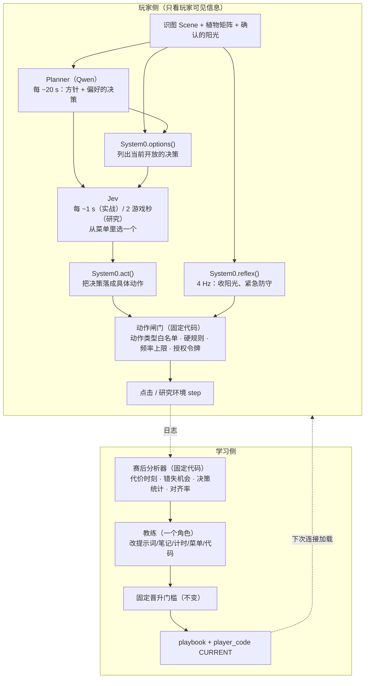

# 改造方案：向 Agnes RSI 框架对齐

2026-11-01 实现；2026-11-02 已随 Codex Coach 接入部署，服务器回归 498 项通过、27 项跳过。尚未验证真实对局收益。

## 实施记录

| 项 | 代码 |
|---|---|
| 阶段 0 核实 | 两个研究环境都自动收阳光：pvz_rl 的 `auto_collect` 默认开，Portable 的 `Harness.cpp` 每步自己收。按 3.5 节处理：收阳光反射只在实战生效 |
| 1 决策菜单 | `server/action_gate.py`（`parse_menu`）、`OneJevSelector.select_menu`、`Plan.preferred_decisions`、playbook `decision.jev_mode` |
| 2 执行层/反射层 | `rsi/code_runtime.py`（可选入口 `options/act/reflex`）、`rsi/native_player.py`（契约 v2、种子、`PlayerRuntime.step(entry)`、失败后重建子进程）、`server/session.py`（菜单路径、`_reflex`）、`rsi/native_bridge.py`（`menu_choice`、`reflex` RPC）、`rsi/native_loop.py`（研究反射种植 + 引擎掩码检查） |
| 3 一个教练 | `rsi/native_engineer.py`（`NativeCoachWorkspace`、`NativeCoachAction`、playbook 文件、测试身份 = 代码 + 段）、`rsi/native_jobs.py`、`server/config.py`（`PVZ_NATIVE_COACH_ACTIONS` / `PVZ_NATIVE_COACH_TESTS`） |
| 4 教练的信息 | `rsi/postgame.py`（四张表、`query_episode`、`find_moments`）、`rsi/review_live.py`（实战表）、研究局报告里的 `postgame` |
| 6 对齐率 | `rsi/postgame.py` 的 `alignment`，研究和实战共用 |
| 测试 | `tests/test_system0_actions.py`（21 项），改写了 `tests/test_native_engineer.py` 的教练流程测试；全套 549 项通过、1 项跳过 |

和方案不同的地方：

- **授权方式**：反射的点击（收阳光、反射种植）用一次性的精确许可（同一帧、同一坐标）；菜单路径的种植仍用「当前 Jev 决策号」授权，
  因为决定权本来就在 Jev。没有另做一套通用令牌。
- **`strategy` 路线**保留为旧选项（默认 `code`），没有删除。
- **一轮多候选**没有实现，只把动作和测试预算做成了配置；每轮仍出一个候选。
- **研究里的反射种植**最多每游戏秒问一次；截图条件下用上一次决策时的识图结果。
- **种子代码**放在旧的五文件布局里：`options/act/reflex` 在 `player/actions.py`，辅助函数在 `player/tools.py`。
- **playbook 新段**会让旧版本 playbook 的摘要变化，进行中的研究任务会被判过期，需要重新排队。

未验证：真实对局里菜单模式是否比内置选择更好、反射调用的实测耗时、Jev 对菜单文字的理解。这些要等研究环境跑通。

### 追加（2026-11-02）：重规划条件

原来实战里阳光或卡片一变、僵尸种类数量变化、前进一格、植物消失（包括樱桃正常爆炸）都会请求重规划，
间隔只受 `danger_min_seconds=4` 限制；Planner 自己填的 `valid_for_seconds` 下限 5，又能把周期缩短。改为：

| 部分 | 代码 |
|---|---|
| 方针给条件 | `server/planner.py`：`Plan.replan_when`（`covered_rows`、`covered_types`、`key_plants`、`goal_plants`、`goal_clear_rows`、`max_failed_steps`），契约里说明何时会被再次调用 |
| System0 检查 | 种子 `decide()` → `seed_replan`：未覆盖的行/类型、依赖植物丢失（一次性植物不算）、目标达成/消失、连续落不了地；方针到达时场上已有的僵尸算已覆盖；每条连续两次成立才算，每份方针只请求一次；原因写进 `planner_context.replan_reasons` |
| 宿主给状态 | 观察加 `plan_status {id, age_s, failed_steps}`；实战 `session._plan_failures`、研究 `Bridge.replans` 统计连续落不了地的决策 |
| 固定边界 | `rules/replan_rules.py`：两次规划至少隔 8 s，方针至少有效 15 s，定时刷新不短于 8 s；教练只能在范围内调 |
| 删除的触发 | 实战的资源变化触发和 `threat_changes`；研究的 `pending_replan_events` |
| 统计 | 赛后表 `planner_calls`（次数、每分钟、按触发方式和原因），`find_moments(kind=replan)`，开发报告汇总 `planner_calls` |
| 测试 | `tests/test_replan.py`（8 项）；全套 578 项通过、1 项跳过 |

没有绑定玩家代码的会话（当前实战 CURRENT 就是）只剩定时刷新，没有提前重规划。

参考：AgnesAI-Labs/Agnes-RSI-Framework-Honor-of-Kings（只有报告，没有代码，结果为作者自报）。
本方案覆盖对比中的第 1、2、3、4、6 项；晋升门槛（第 5 项）和截图感知（第 7 项）不在范围内，保持不变。

| # | 改什么 | 一句话 |
|---|---|---|
| 1 | Jev 的决策空间 | Jev 从「卡槽×行×列」改为从**有名字的决策菜单**里选，菜单由 playbook 定义、教练可增删 |
| 2 | System0 的权限 | System0 从「递纸条」变成**执行层 + 反射层**：把 Jev 的决策落成具体动作，并以 4 Hz 跑反射（收阳光、紧急防守） |
| 3 | 谁改什么 | Coach / Engineer 合并成**一个教练**，一次候选可以同时改提示词、笔记、计时、决策菜单和代码 |
| 4 | 教练的信息 | 教练拿到**代价最大时刻表、错失机会表、决策统计、真值局面**和只读查询工具 |
| 6 | 规划→执行对齐 | 测量「方针一换，Jev 下一步是否跟着换」，进日志、复盘和开发报告 |

---

## 0. 现状（改造起点）

代码事实，供对照：

- Jev：`server/action_selector.py` 的 `candidates()` 枚举全部 `(slot,row,col)`，用 `DecisionContext.reject()` 过滤；
  分层模式先选「植物+行」再选「列」，每步含 wait。决策空间写死在代码里，没人能改。
- System0：`rsi/native_player.py`。`validate_result()` 只接受 `{planner_context, jev_context, request_replan}`，
  CONTRACT 写明不能发鼠标事件、不能替代 Jev、不能改收阳光。
- 点击：`Session._execute_placement`（`server/session.py:416`）把 Jev 的选择翻成两次点击；
  `Session._collect_suns` + `server/sun_collector.py` 每 0.25 s 收两帧确认的阳光。
  `Session.send` 只认两种授权：`sun_collector`（必须是当前精确目标）和 `onejev`（必须是当前 Jev 决策号）。
- 规则基线：`server/decider.py` 已有 `emergency / attack / reinforce / economy / follow_plan / wait` 六种战术，
  各自从状态算出具体格子。它们正好可以作为新决策菜单的种子实现。
- 学习：`native_evolution=code` 时 Coach（`rsi/native_engineer.py` 的 `COACH_SYSTEM`）只写诊断，
  Engineer 只能改 `player/`，最多 12 个动作、2 次开发测试；`strategy` 时 Coach 只能改 `planner.knowledge`。
- 复盘证据：`rsi/review_live.py` 的 `build_evidence()` 和开发集 `summary()`（几条里程碑 + 末尾轨迹），没有统计表。

---

## 1. 目标架构



和现在相比，固定不动的有：识图、Planner 的 CONTRACT、Jev 的协议（`jev27-bare-v1` 文字选项）、
硬规则、裁判、评分、晋升门槛、信息隔离。可进化的部分从「给模型的参考文字」扩大到「决策菜单 + 执行 + 反射」。

---

## 2. 第 1 项：决策菜单

### 2.1 形式

System0 新增入口函数 `options(observation, memory)`，返回当前开放的决策列表：

```json
[
  {"id": "defend_row_2", "text": "加固第 2 行：补一个攻击植物（豌豆/寒冰）", "tags": ["defense"], "rows": [2]},
  {"id": "economy",      "text": "补经济：种一棵向日葵",                       "tags": ["economy"], "rows": []},
  {"id": "emergency_row_4", "text": "第 4 行紧急：樱桃/土豆雷清场",           "tags": ["defense"], "rows": [4]},
  {"id": "save_sun",     "text": "存阳光，本拍不种",                           "tags": ["save_sun"], "rows": []}
]
```

- `id`：小写标识符，≤40 字符；`text`：给 Jev 看的一句话，≤160 字符；`tags` ⊂ Planner 的 `priorities` 枚举；
  `rows` 为该决策涉及的行（供对齐统计用）。最多 24 项。`wait` 由宿主固定追加，System0 不能删。
- 菜单是**代码算出来的**：只有当前确实能执行的决策才出现（例如没有可用的樱桃卡就不出现紧急清场）。
  这相当于绝悟的动作掩码，由 System0 负责，最终仍由闸门复核（第 3 节）。
- 决策的种类、措辞、出现条件都写在 player 代码里，教练可以增删改。种子版本把 `server/decider.py` 的六种战术
  按行展开，行为上尽量贴近现有规则基线。

### 2.2 Jev 怎么选

`OneJevSelector` 增加 `mode="menu"`：一次 `rank_choice`，选项为 `wait + 菜单`，state 与现在相同
（方针、预算建议、局面、System0 上下文……），外加 `planner_preferred_decisions`（见第 6 节）。
保留现有 `hierarchical / flat` 模式，由 playbook 新增的 `decision.jev_mode` 选择，方便 A/B。
（不放在现有 `jev` 段：那一段是规则基线的旧战术，OneJev 模式下 `active_dump()` 会把它整段去掉。）

失败语义不变：调用失败、超时、返回不在菜单里，一律等待。

### 2.3 决策落地

System0 新增 `act(observation, memory, decision_id)`，返回 0–2 个具体动作（第 3 节的动作格式）。

- 返回空表示「这个决策现在落不了地」，记 `decision_unexecutable` 事件，本拍等待。这是教练的重要信号
  （菜单写得不准）。
- 落地结果必须过闸门。被闸门拒绝也记事件，不重试别的格子。

### 2.4 Planner 的配合

`Plan` 增加一个可选字段 `preferred_decisions: list[str]`（≤6 个菜单 id），仍然是建议而不是命令，不含坐标。
Planner 的输入里加当前菜单（id + text）。这样方针和 Jev 的选项用的是同一套词，对齐可以直接统计。

---

## 3. 第 2 项：System0 变成执行层和反射层

### 3.1 新的运行时契约（v2）

| 入口 | 何时调用 | 返回 |
|---|---|---|
| `perceive(image)` | 每次调用前 | 派生观察（不变） |
| `decide(obs, memory)` | Planner / Jev 调用前 | `{planner_context, jev_context, request_replan}`（不变） |
| `options(obs, memory)` | Jev 调用前 | 决策菜单（新） |
| `act(obs, memory, decision_id)` | Jev 选完后 | 动作列表（新） |
| `reflex(obs, memory)` | 每 0.25 s | 动作列表（新） |

五个入口共用一份按局隔离的 `memory`。旧代码只定义前两个时，宿主按 v1 行为运行（菜单退回现有的
「植物+行 → 列」，反射退回现有 `sun_collector`），所以已晋升的版本不需要迁移。

### 3.2 动作格式和闸门

System0 只能返回两类动作：

```json
{"type": "collect_sun", "sun": 3}
{"type": "plant", "slot": 1, "row": 2, "col": 4}
```

- `collect_sun` 只能**引用**观察里已确认的第 3 个阳光（`observation.suns[3]`），不能给坐标。
  坐标由宿主从 `SunCollector.targets()` 取，所以 System0 只能决定收哪些、按什么顺序，没法点阳光以外的地方。
- `plant` 必须通过 `DecisionContext.reject()`（新鲜度 + `hard_rules.check` + 费用已知 + 研究环境的原生掩码）。
- 闸门（新文件 `server/action_gate.py`，教练不可编辑）：
  1. 类型白名单，只有这两种；
  2. 每拍上限：`reflex` 每拍最多 2 个 `collect_sun` + 0 个 `plant`（默认），`act` 每拍最多 1 个 `plant`；
  3. 反射种植默认关闭，由 playbook 的 `reflex.allow_planting`（bool）和 `reflex.min_plant_interval_s`（≥2）打开；
     这两个字段在 `rules/playbook_rules.py` 里固定范围；
  4. 生成一次性授权令牌，`Session.send` 只认令牌，替代现在按 `decision_source` 标签判断的方式。
     令牌绑定 `(帧号, 动作, 坐标)`，过期作废，和现有阳光许可 `_sun_permit` 的做法一致；
  5. 所有动作仍在 `_action_lock` 下下发，种植动作照常写入 `placed_since / used_slots / sun_spent / directive_spent`。

### 3.3 收阳光迁入 System0

- 种子 `reflex()` 复刻现在的行为：收全部已确认阳光，每拍最多 2 个。
- 演化空间：先收哪些（离卡槽近的、快要消失的）、种植排队时让路等。
- 「两帧确认」留在宿主的 `SunCollector` 里，作为感知事实，不让 System0 改；System0 只做取舍。

### 3.4 性能

现在 `PersistentWorker` 每次调用是一次 JSON 往返，墙钟上限 3 s。反射每 0.25 s 一次：

- 反射调用单独设 150 ms 上限，超时本拍不动作，并记 `reflex_timeout`；连续 5 次超时就在本局停用反射，
  退回宿主默认收阳光；
- 观察里去掉 `pixels`（反射用不到，省一次 JPEG 解码），只在 `decide` 时提供；
- 开发报告里加入 `reflex_s` 的 p50/p95，教练能看到自己代码的耗时。

### 3.5 研究环境要补的东西

这是本方案最大的未知数，**实施前必须先核实**：

- pvz_rl：`NativeArena.step()` 只接受 `placement`（动作 = `1 + slot*54 + row*9 + col`），
  `player_state()` 不输出地上阳光。需要查上游 `pvz_gym` 是否自动收阳光、是否有收阳光动作。
- Portable：`PortableArena.step()` 走 `Harness.cpp` 的 `step 25 slot row col` 命令，同样没有阳光对象和收取命令。
  Portable 是我们自己打补丁的源码，可以加 `suns` 输出和 `collect <id>` 命令。

如果研究环境自动收阳光，`reflex` 里的收阳光部分在研究中就测不出效果，只能当作「实战专用、不参与晋升」的参数，
晋升门槛照旧只看研究结果。决策菜单和 `act` 不受影响，两个环境都能测。

---

## 4. 第 3 项：一个教练

### 4.1 合并方式

把 `COACH_SYSTEM`（诊断）和 `ENGINEER_SYSTEM`（实现）合成一个角色，沿用 Engineer 的工具和虚拟工作区，
但工作区里多放几份 playbook 文件：

```
playbook/planner_knowledge.md   ← playbook.planner.knowledge（Planner 的策略笔记）
playbook/timing.json            ← playbook.timing（各路周期、危险重规划）
playbook/decision.json          ← decision.jev_mode（新段）
playbook/reflex.json            ← reflex.allow_planting / min_plant_interval_s（新段）
player/*.py                     ← System0：perceive / decide / options / act / reflex
docs/contract.txt               ← 只读
evidence/*.json                 ← 只读，第 5 节的分析表
```

- `finish` 时打包成一个候选：新 playbook 版本，同时带上改过的 playbook 段和新的 `player_code`。
  playbook 段照常用 `rules/playbook_rules.py` 校验范围；`perception` 和 `fast` 段不放进工作区
  （它们是截图感知参数，属于第 7 项，不在范围内）。
- `native_evolution` 的 `strategy` 路线并进来，变成「只改了 `planner_knowledge.md`」的一种候选，不再单独存在。
- 固定不可改：Planner 的 CONTRACT、Jev 协议、硬规则、动作闸门、裁判、评分、门槛、种子集。

### 4.2 一轮多个候选

Agnes 每轮 1–6 个候选，最多晋升 1 个（1v1 的 111 个候选里晋升了 4 个）。我们现在每轮只有 1 个。建议：

- 每轮最多 3 个候选，每个候选最多 2 次开发测试，动作预算从 12 提到 20；
- 开发集成绩最好且过开发门槛的那一个进入确认和审计，其余记入 ledger；
- 教练能看到所有历史候选的诊断、改动和开发成绩（现在只给最近 8 个），用于避免重复尝试。

代价：每多一个候选，就多 1–2 轮开发测试（每轮 8 局）。研究环境跑通、测出每小时局数之前，先保持每轮 1 个，
只把预算参数做成可配置。

---

## 5. 第 4 项：教练能看到的信息

Agnes 3v3 的教训：教练只看有限视图时，18 轮、56 个候选没赢过一局；给了完整赛后视图才开始赢。

### 5.1 赛后分析器（新文件 `rsi/postgame.py`，固定代码，不调模型）

输入为研究对局的完整轨迹（真值局面，研究环境里每 0.25 游戏秒都有）和实战日志（`events.jsonl`）。输出四张表：

1. **代价最大时刻表**：每次小推车触发、植物被吃、某行防线被突破，记录：
   时间、行、当时该行的僵尸和植物、阳光、可用卡、之前 10 s 内的菜单、Jev 的选择、方针、System0 输出。
2. **错失机会表**：「阳光 ≥ 某卡费用、卡可用、某行受威胁且火力不足」持续超过 3 s，Jev 却在等待、
   菜单里没有对应决策，或 `act` 落不了地。按时长排序，取前 20 条。
3. **决策统计**：每个决策的出现次数、被选次数、落地失败次数、平均得分；wait 占比；反射动作数；
   各环节耗时 p50/p95。
4. **对齐表**：第 6 节的指标。

实战局没有真值局面（实时裁判只读小推车、时钟、胜负），表 1 和表 2 在实战局里用识图结果近似，并标明「玩家视角」。

### 5.2 只读查询工具

教练工作区加两个工具，只能查**开发集**和当前最佳版本的历史开发局，碰不到确认集和审计集：

- `query_episode(episode, tick_from, tick_to)`：返回这一段的逐拍真值、菜单、选择和动作；
- `find_moments(condition)`：按固定的几类条件检索（小推车触发、植物丢失、长时间等待、落地失败），
  返回时间点列表。

### 5.3 隔离不变

- 真值只给教练和分析器。Planner、Jev、System0 的输入白名单不变：研究的 state 条件仍走 `player_state()`，
  pixels 条件不带任何 state 字段。
- 新增自动测试（参考 Agnes 的做法）：随机篡改轨迹里所有玩家不可见的字段，确认发给 Planner、Jev、System0 的
  输入逐字节不变。

---

## 6. 第 6 项：Planner→Jev 对齐率

### 6.1 定义

决策 d 和方针 P **一致**，当且仅当满足以下任一条：

- d 在 `P.preferred_decisions` 里；
- d 的 `tags` 与 `P.priorities` 的第一项相同，且（d 没有 `rows`，或 d 的 `rows` 与 `P.priority_rows` 有交集）；
- d 是 wait / save_sun，且 `P.priorities[0] == "save_sun"`。

- **换方针后对齐率**：每次新方针生效后，Jev 的第一次非空决策与新方针一致的比例；
- **基线**：同一时刻之前的最后一次 Jev 决策与**新**方针一致的比例。

两者之差说明方针到底有没有改变 Jev 的行为。Agnes 报告的数字是 34% → 60%。

### 6.2 落在哪里

- `server/session.py` 和 `rsi/native_bridge.py` 在每次 Jev 决策的日志里记录 `plan_id` 和 `aligned`；
- 赛后分析器汇总成第 5.1 节的表 4；
- 实战复盘（`rsi/review_live.py`）和开发报告都显示这两个数；
- 只做诊断，不进晋升门槛。

在现有架构上（还没有菜单时），可以用「Jev 选的植物+行」近似 tags 和 rows，先测出当前基线。

---

## 7. 实施顺序

每一步都能单独上线、单独回退。

| 阶段 | 内容 | 主要文件 | 前置条件 |
|---|---|---|---|
| 0 | 核实研究环境的阳光和动作接口；在现有架构上测出对齐率基线 | `rsi/native_runtime.py`、`rsi/portable_runtime.py`、`server/session.py` | 无 |
| 1 | 赛后分析器 + 查询工具（第 4 项） | 新 `rsi/postgame.py`，`rsi/native_engineer.py`、`rsi/review_live.py` | 无，对现有学习也有用 |
| 2 | 运行时契约 v2、动作闸门、决策菜单、`act`（第 1、2 项，不含反射） | `rsi/native_player.py`、新 `server/action_gate.py`、`server/action_selector.py`、`server/session.py`、`rsi/native_bridge.py`、`server/planner.py`、`rules/playbook_rules.py` | 阶段 0 |
| 3 | 反射层，收阳光迁入 System0 | 同上 + `server/sun_collector.py`；研究环境视阶段 0 结论补接口 | 阶段 2 |
| 4 | 合并教练、一轮多候选（第 3 项） | `rsi/native_engineer.py`、`rsi/code_engineer.py`、`rsi/native_jobs.py` | 阶段 1、2 |

每个阶段的验收：

- 现有测试全过；
- 种子 v2 代码（复刻现有行为）在离线夹具上的动作序列与 v1 相同，或差异有逐条解释；
- 新闸门的拒绝路径有单元测试：越权动作类型、伪造坐标、超频、过期令牌、反射种植未开启；
- 隔离测试（5.3）通过。

---

## 8. 风险和代价

1. **研究环境还跑不起来。** pvz_rl 缺 1.2.0.1065 游戏，Portable 的试跑卡在 `Jev failed: ConnectError`。
   新架构下教练能改的东西更多，更需要大量对局来筛选。不先解决这个，第 3、4 项只能改，不能晋升。
2. **System0 有了动作权。** 教练写的代码会直接影响点击。缓解：动作类型白名单、硬规则、频率上限、令牌、
   反射种植默认关闭、晋升门槛不变；实战另设一个总开关 `PVZ_SYSTEM0_ACTIONS`，出问题时一键退回 v1 行为。
3. **Jev 在抽象决策上未必更好。** 菜单让选项变少、语义更清楚，但也把选格子交给了代码。
   保留 `hierarchical / flat` 模式，用开发集 A/B 决定默认值。
4. **搜索空间变大，产出率变低。** Agnes 的 1v1 产出率约 4%，而且每个候选都要真实对局。
   一轮多候选要等研究吞吐测出来再开。
5. **反射的耗时。** 0.25 s 一次的子进程往返在实战机器上未实测，阶段 3 先测 p95。
6. **兼容旧版本。** v1 的 player_code 和没有 `preferred_decisions` 的旧方针都要继续可读，
   不能改动已晋升版本的行为。

---

## 9. 不在范围内

- 晋升门槛（对历史最佳版本测、没见过的关卡测泛化）：第 5 项，以后另议；
- 截图感知（识图、阳光 HSV、`perception` / `fast` 段）：第 7 项，不动；
- 训练任何模型权重。
